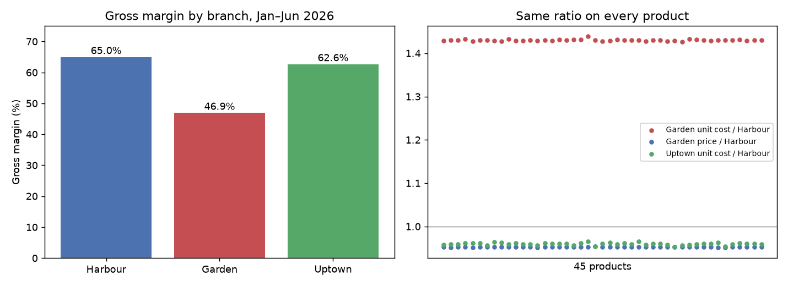

# Stories Coffee: Where the Margin Leaks

**EECE490 Stories Coffee Hackathon**

**Team members:** Rudy Abedulhadi · Karen El Helayel · Jad Faddoul

## Conclusion (one paragraph)
**Garden loses about $16k of gross profit every six months (≈$32k a year at today's volume), and nearly all of it comes from a single cost rule, not from how the branch operates.** Garden's recorded unit cost is **1.430× Harbour's on every one of 45 products**. The ratio holds in every month, every category, and for both dine-in and takeaway. That pulls Garden's gross margin down to **46.9%**, against **65.0%** at Harbour and **62.6%** at Uptown. Product mix explains only 0.3 points of the 18-point gap and Garden's lower prices 1.8 points; **costs explain 16.0 points**. A multiplier this uniform does not look like waste, theft or spoilage. Those would vary by product perishability and over time. It points to one branch-level input: a supplier or distributor contract, or an overhead allocation booked into unit cost. **Recommended action:** before changing anything operational, Stories should audit how Garden's unit costs are produced, using 4 weeks of invoices for its top 10 products against Harbour's. If the gap is a real purchase price, move Garden onto Harbour's supply terms. Raising Garden's prices instead is worth at most ≈$10k a year, and nothing if demand is price-sensitive (elasticity −2). We also found that the March and May discount campaigns came with **−3.9% transactions** against matched days, and that a forecasting model beats a simple baseline by only a small margin. Both are secondary to the cost audit.

> **Measured vs estimated.** Every number marked *(measured)* comes directly from the data via `analysis/`. Every $ "value" is an *(estimate)* resting on the assumptions in [§5](#5-assumptions-and-how-they-change-the-answer).

---

## 1. Business problem and why we chose it
Stories' data team already knows how many lattes each branch sells. We looked for something a sales dashboard would **not** show: why one of three branches earns far less per dollar sold, and whether that is fixable.

- **Chosen:** F1, branch margin leakage. It is the largest $ lever in the data, and it leads to a concrete, cheap first action.
- **Also tested:**
  - F2: did the discount campaigns pay off?
  - F3: can demand forecasting improve staffing? Brief answer: only slightly.

## 2. F1: Garden margin leak (main finding)
**Evidence** (`python analysis/f1_garden_margin.py` → `outputs/f1_*`):

| Branch | Revenue (measured) | Gross profit (measured) | Gross margin |
|---|---:|---:|---:|
| Harbour | $150,099 | $97,503 | **65.0%** |
| Garden | $99,531 | $46,696 | **46.9%** |
| Uptown | $55,554 | $34,795 | **62.6%** |



**Margin bridge, Harbour → Garden** (`outputs/f1_margin_bridge.csv`, measured). It is a sequential decomposition on Garden's actual basket:

| Step | Gross margin | Change |
|---|---:|---:|
| Harbour actual | 64.96% | |
| Garden's product mix and discounts, at Harbour prices and costs | 64.65% | −0.31 pts |
| Garden's prices (4.8% below Harbour) | 62.88% | −1.77 pts |
| Garden's unit costs (1.43× Harbour) | **46.92%** | **−15.96 pts** |

**Challenging our first explanation** (R03, R04). We tested each alternative:

| Alternative explanation | Test | Result |
|---|---|---|
| Garden sells lower-margin items (mix) | Garden basket at Harbour prices and costs | Only −0.3 pts. **Rejected** |
| A supplier price rise during the period | Cost ratio by month | 1.4299–1.4301 in all 6 months. **Rejected** |
| Waste or spoilage of perishables | Cost ratio by category (perishable food vs drinks) | 1.4285–1.4311 for all 9 categories. **Rejected** |
| Packaging for takeaway | Cost ratio by order type | Exactly 1.4300 for both. **Rejected** |
| Duplicate lines distorting the picture | Margins with and without the 132 duplicates | Identical to 0.1 pt. **Rejected** |
| Premium ingredients at Garden | Premium inputs would usually justify higher prices; Garden is 4.8% *cheaper* | Not supported, but **cannot be ruled out** without recipe and supplier data |
| **Branch-level cost rule** (contract markup or overhead allocation) | A single constant multiplier on every item is what this cause would produce | **Consistent with all tests** |

Garden's weakest products sit around 29–34% margin: Sparkling Water, the Turkey & Cheese and Chicken Pesto sandwiches, Brownie and Cheesecake (`outputs/f1_garden_product_margins.csv`). Garden also sells more desserts than the other branches (11.0% of lines, versus 7.8% at Harbour and 6.9% at Uptown). At Garden's costs, desserts earn 35.6%, against 56.5% at Harbour (`outputs/f1_category_mix_and_margin.csv`).

**Value** (`outputs/f1_value_scenarios.csv`). All figures are **estimates**, annualised as 2× H1 2026 at flat volume (assumption A6):

| Action | Gross profit per year |
|---|---:|
| A. Garden unit costs at Harbour's level | **+$31.8k** |
| B. Close half of the cost gap | +$15.9k |
| C. Garden unit costs at Uptown's level | +$34.7k |
| D. Raise Garden prices to Harbour's (+5%), elasticity 0 / −1 / −2 | +$9.9k / +$5.0k / +$0.3k |

**Costs and tradeoffs:**
- The audit itself is cheap: invoices and the costing sheet.
- Switching supplier may change quality or reliability, so taste-test and check delivery.
- The price route (D) risks traffic. 94% of known customers visit two or more branches, so they would notice a price change (`outputs/f1_shared_customers.csv`).

**Practical test before wider use** (R09):
1. Pull 4 weeks of supplier invoices for Garden's and Harbour's top 10 products by volume, and compare the landed cost per unit.
2. Ask finance how "Unit Cost" is calculated for each branch.
3. If the gap is a real purchase price, move 3 products (for example Iced Latte, Butter Croissant, Brownie) onto Harbour's supplier for 4 weeks. Check that recorded unit cost drops while sales per day and the product mix stay within their normal weekly range.

## 3. F2: Discount campaigns (secondary)
Campaign days were **detected from the data**: days whose share of discounted lines exceeded the median plus 3 robust standard deviations. That gives two 8-day bursts, 12–19 March and 12–19 May, plus 3 isolated days. The 15% discount tier exists only at Harbour (`outputs/f2_*`).

- **Measured:** across 57 branch-days, transactions were on average **3.9% *below*** the same weekday 1–3 weeks before and after. Only 35% of branch-days showed any lift. Gross profit was $1,158 below the matched days, and $666 of discount was given on those days.
- **Is that noise?** We built a placebo check: the same method on random non-campaign days, averaged over 57 days. Only **2.5%** of those placebo averages came out as low as −3.9%.
- **Not causal** (R10). Campaigns may have been launched *because* traffic was weak (reverse causality), and nearby holidays are not in the data.
- **Discounted baskets are larger** (1.81 vs 1.57 items, AOV $9.60 vs $8.94). This is correlation only: discounts may be tied to combos.
- **Value is small.** Total discount over 6 months was $2,176 (measured). **Action:** run the next campaign as a geographic A/B test, discounting at one branch and holding out a comparable one, before running it chain-wide.

## 4. F3: Demand forecast for staffing (tested, modest value)
Target: transactions per branch per hour, 07:00–23:00. **Trained on January–May. June was held out and never used for fitting** (R07).

- **Baseline:** the mean of the last 4 same-weekday, same-hour values.
- **Model:** a Poisson GLM using branch×hour, branch×weekday and branch×trend.

| Holdout (June) | Baseline WAPE | Model WAPE | Baseline bias | Model bias |
|---|---:|---:|---:|---:|
| Branch-day | 11.5% | **9.0%** | −7.5% | **+0.4%** |
| Branch-hour | 39.3% | **35.9%** | −7.5% | +0.4% |
| Tuesdays (branch-hour) | 33.1% | 30.2% | −6.9% | +0.1% |


- **Measured patterns:**
  - Tuesday carries **1.61×** the transactions of the average other weekday. That holds in **every one of 25 weeks** (range 1.44–1.81), so it is not driven by outliers.
  - The 21:00 hour alone carries 12.6% of all lines (`outputs/f3_hour_share_of_lines.csv`).
  - Monthly transactions grew 52% from January to June (`outputs/f3_monthly_transactions.csv`), at all three branches.
- **Why the value is modest:**
  - A branch sees only about 2–8 transactions an hour.
  - The baseline's main error is that it lags the growth trend (−7.5% bias). The model fixes that.
  - In a staffing simulation (assumption A7: one staff member per 15 transactions an hour), the model cut short-staffed hours in June from 15 to 12, at the cost of 9 extra staff-hours.
  - **We do not recommend investing in a complex forecasting system.** A simple trend adjustment plus a fixed Tuesday and evening roster captures most of the benefit.
- **Not tried, by design:** a gradient-boosted tree model. Trees cannot extrapolate a growth trend, and the trend is the main thing a forecast must capture here. This is a reasoned choice, not a tested result.

## 5. Assumptions and how they change the answer
| ID | Assumption | If it is wrong… |
|---|---|---|
| A1 | "Unit Cost" is Stories' per-unit cost of goods as recorded by finance | If it includes a rent or overhead *allocation*, the $16k is not cash to recover. The action becomes "fix the costing so Garden's menu and pricing decisions aren't distorted", and scenario D (pricing) becomes the wrong move. **This is the assumption most likely to change the recommendation.** |
| A2 | The 132 identical lines ($741 of revenue) are double-logged | Margins change by under 0.1 pt, so it doesn't matter |
| A3 | A blank Customer ID means a non-loyalty customer | Affects only the "94% visit 2+ branches" statistic |
| A4 | Branch names are anonymised; Lebanese context (USD pricing, imported inputs, generator power) is background only | Not used as evidence |
| A5 | Price elasticity at Garden is unknown, so we swept 0 to −2 | Pricing value ranges from $10k to $0 a year |
| A6 | Annual = 2× H1 at flat volume | Conservative: transactions grew 52% from January to June |
| A7 | One staff member handles 10–20 transactions an hour | Changes the staffing numbers, not the forecast ranking |

## 6. Weak areas, uncertainty and missing information
- **Missing information:** supplier invoices, how unit cost is calculated, rent and labour, the campaign calendar, holidays, stock-outs, and weather. With these, F1 becomes a confirmed cash number and F2 becomes causal.
- **Six months only:** no seasonality across a full year. Summer 2026 may differ.
- The F2 placebo test assumes campaign days are otherwise comparable to random days. Holidays could break that.
- The data's exact ratios and the absence of any price change suggest the costing may be formula-driven. We treat that as a finding to verify, not a certainty.

## 7. Reproduce
```bash
python -m venv .venv
.venv\Scripts\activate          # Linux/macOS: source .venv/bin/activate
pip install -r requirements.txt
# place stories_transactions.csv in data/
python analysis/run_all.py      # rewrites every table and chart in outputs/ (~20 s)
```

| Path | Contents |
|---|---|
| `analysis/common.py` | Loading, cleaning (de-duplication), data-quality checks → `outputs/data_quality.csv` |
| `analysis/f1_garden_margin.py` | Branch P&L, unit ratios, margin bridge, alternative-explanation tests, value scenarios |
| `analysis/f2_promotions.py` | Campaign detection, matched-day comparison, placebo test |
| `analysis/f3_demand_forecast.py` | Baseline vs Poisson model, June holdout, staffing simulation |

**Data quality** (`outputs/data_quality.csv`, measured): 51,177 lines and 33,887 transactions from 2026-01-01 to 2026-06-30. Revenue and gross profit reconcile on 100% of lines. No transaction has conflicting header fields. Each product has one price and one unit cost per branch for the whole period. 132 exact duplicate lines were removed. 36.5% of lines have no Customer ID.
