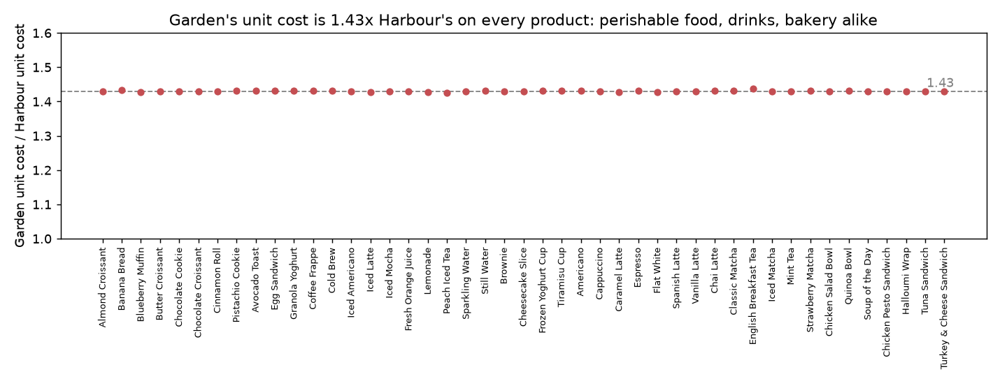
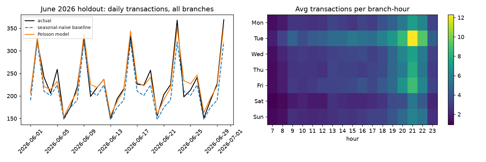

# Stories Coffee: Where the Margin Leaks

**EECE490 Stories Coffee Hackathon**

**Team members:** Rudy Abedulhadi · Karen El Helayel · Jad Faddoul

## CEO decisions
| # | Decision | Value / year *(estimate)* | Confidence | First step this week |
|---|---|---|---|---|
| 1 | **Audit the unit-cost rule and benchmark every branch against the cheapest cost base (Uptown)** | **$32k–$39k** from Garden (vs Harbour's costs; flat volume to June run-rate) + $4k from Harbour (vs Uptown's), *if the gap is an avoidable purchase cost*. $0 cash if it is an accounting allocation, but then the menu and pricing decisions built on those margins are wrong | Gap: **high** (measured on every product and month). Recoverable share: **unknown** (assumption A1) | Finance explains how "Unit Cost" is set per branch; pull 4 weeks of invoices for the top 10 products, desserts first |
| 2 | **Stop blanket 15% category discounts; approve promotions only with the break-even rule (§3)** | Small: ≈$0.7k/yr at the current pace. The value is avoiding larger loss-making promotions | **High** that a lift big enough to pay for the 15% promo did not happen (ruled out at about the 95% level) | Run the next promotion at one branch for 2 weeks, with the other two as control |
| 3 | **Staff to the demand shape: Tuesday +59%, Saturday −28%, thin 07:00 and 23:00 hours** | Not sized: there is no labour data | **High** on the pattern (every week); value depends on wage and generator cost | Move one shift from Saturday to Tuesday 19:00–22:00; record each branch's hourly labour + energy cost |

## Conclusion
Garden's recorded unit cost is **1.430× Harbour's on every one of 45 products, and the monthly ratio never moves by more than ±0.0001**. That costs **$15.9k of gross profit in six months** *(measured)*, which is **8.9% of the chain's gross profit and 34% of Garden's**. Annualised, that is **$32k at flat volume, or $39k at Garden's June run-rate** *(estimates; we would budget $32k)*. A ratio this exact comes from a formula, not from waste or purchasing. So the first action is cheap: find the costing rule before changing operations. Our confidence that the gap exists is high; that the cash is recoverable, unknown.

> **Measured vs estimated.** *(measured)* numbers come directly from the data via `analysis/` (see the [Evidence index](#8-evidence-index)). Every $/year "value" is an *(estimate)* resting on the assumptions in [§5](#5-assumptions-and-how-they-change-the-answer).

---

## 1. Business problem and why we chose it
Stories' data team already knows how many lattes each branch sells. We looked for what a sales dashboard does **not** show: why one branch earns far less per dollar sold, whether that is fixable, and whether current promotions and staffing match how customers actually behave.

## 2. F1: The cost rule behind Garden's margin (main finding)
| Branch | Revenue *(measured)* | Gross profit *(measured)* | Gross margin | Unit cost vs Uptown, every product |
|---|---:|---:|---:|---:|
| Harbour | $150,099 | $97,503 | **65.0%** | 1.036–1.050× |
| Garden | $99,531 | $46,696 | **46.9%** | 1.48–1.50× |
| Uptown | $55,554 | $34,795 | **62.6%** | 1.00× (cheapest) |



**Margin bridge, Harbour → Garden** *(measured, `outputs/f1_margin_bridge.csv`)*:

| Step | Gross margin | Change |
|---|---:|---:|
| Harbour actual | 64.96% | |
| Garden's product mix and discounts, at Harbour prices and costs | 64.65% | −0.31 pts |
| Garden's prices (4.8% below Harbour) | 62.88% | −1.77 pts |
| Garden's unit costs (1.43× Harbour) | **46.92%** | **−15.96 pts** |

**Why this is a costing rule, not waste.** Aggregated by month, the Garden/Harbour cost ratio is **1.4299–1.4301**. Per product it is 1.426–1.439, and the spread is exactly what rounding to the cent produces. For example, English Breakfast Tea costs $0.57 at Harbour, and $0.57 × 1.43 = $0.815, recorded as $0.82 (ratio 1.439). Real purchasing does not produce one constant multiplier across coffee beans, milk, croissants, sandwiches and bottled water for six months. That precision comes from a formula: a markup or allocation applied to a base cost. Each alternative was tested:

| Alternative explanation | Test | Result |
|---|---|---|
| Garden sells lower-margin items (mix) | Garden basket at Harbour prices and costs | Only −0.3 pts. **Rejected** |
| A supplier price rise during the period | Cost ratio by month | 1.4299–1.4301 in all 6 months. **Rejected** |
| Waste or spoilage of perishables | Cost ratio by category | 1.4285–1.4311 for all 9 categories. **Rejected** |
| Packaging for takeaway | Cost ratio by order type | Exactly 1.4300 for both. **Rejected** |
| Duplicate lines | Margins with and without the 132 duplicates | Identical to 0.1 pt. **Rejected** |
| Premium ingredients at Garden | Premium inputs would usually carry higher prices; Garden is 4.8% *cheaper* | Not supported, but **cannot be ruled out** without supplier data |
| **Branch-level cost formula** (contract markup or overhead allocation) | A constant multiplier is what this cause produces | **Consistent with all tests** |

Harbour shows the same signature on a smaller scale: **1.036–1.050× Uptown on every product** *(measured, `outputs/f4_cost_ratio_vs_uptown.csv`)*. So the benchmark should be the cheapest cost base, Uptown, not Harbour.

**Decision tree for the audit** (sizes from `outputs/f4_cost_benchmark.csv`, 6-month *measured* gaps):
- **If the gap is a purchase price** (Garden's supplier or contract): move Garden, and then Harbour, onto Uptown's terms. That is worth $17.4k (Garden) + $2.1k (Harbour) = **$19.5k per 6 months**, or ≈$39k a year at flat volume *(estimate)*. Check quality and delivery reliability before switching.
- **If it is an overhead allocation** (rent, generator power or management fees booked into unit cost): there is **$0 cash to recover**. But every product-level margin at Garden is distorted. For example, Garden's desserts *appear* to earn 35.6% against 56.5% at Harbour *(measured, `outputs/f1_category_mix_and_margin.csv`)* and would wrongly be cut. Move the allocation out of unit cost so menu and pricing decisions use true product margins.

**Branch mix makes the audit more urgent at Garden** *(measured, stable in every month, `outputs/f4_branch_mix_index.csv`)*:
- Desserts are 11.0% of Garden's lines, against 7.8% at Harbour and 6.9% at Uptown. That is 1.27× the chain share every month (range 1.18–1.33). Tiramisu, Frozen Yoghurt and Brownie each run about 1.31× the three-branch average share (`outputs/f4_product_mix_index.csv`).
- Desserts are Garden's lowest-margin category at its current costs, so **start the invoice audit with dessert products**.
- Uptown sells sandwiches at 1.41× the chain share every month (10.2% of lines vs 6.5%), led by Halloumi Wrap (1.38×). Action: test a lunch sandwich + drink bundle at Uptown.
- These are associations: we cannot see *why* each branch's customers buy differently.

**Price harmonisation: an optional test, not a recommendation** (`outputs/f4_price_harmonisation.csv`, *estimates*). Garden prices are 4.8% and Uptown's 8.6% below Harbour's. Raising them to Harbour's would add, per 6 months:

| Elasticity *(assumption)* | 0 | −0.5 | −1 | −1.5 | −2 |
|---|---:|---:|---:|---:|---:|
| Garden (+5.0%) | +$5.0k | +$3.7k | +$2.5k | +$1.3k | +$0.2k |
| Uptown (+9.4%) | +$5.2k | +$3.5k | +$1.8k | +$0.2k | −$1.4k |

94% of known customers visit two or more branches (`outputs/f1_shared_customers.csv`). Customers would see the gap, and might shift branches rather than pay more. Test price changes on 3–5 products for 4 weeks before any menu-wide change.

## 3. F2: Harbour's 15% promotions did not pay for themselves
**What the data shows** (`outputs/f2_facts.csv`, *measured*):
- The 15% discount appears **only at Harbour**, on **16 days** (12–19 March and 12–19 May), and **only on Cold Coffee and Desserts**.
- On those days every unit of those products was discounted.
- A separate 10% discount runs at a steady background rate everywhere.

**Design: a difference-in-differences comparison** (`analysis/f2_promotions.py`). For each promo day, Harbour's sales are compared with the same weekday 1–3 weeks before and after. We subtract the same comparison for Garden and Uptown on the same categories and days, which removes chain-wide effects. A placebo check runs the identical method on 1,000 random sets of 16 non-promo days.

| Harbour, promo days vs matched days | Harbour change | Garden+Uptown change | **Difference-in-differences** | 95% chance range (placebo) |
|---|---:|---:|---:|---:|
| **Units of promoted items** | −3.3% | −7.5% | **+4.2%** | −13.5% … +16.5% |
| Gross profit on promoted items | −24.7% | −7.9% | −16.9% | −15.1% … +15.9% |
| Units of other items (halo?) | −2.6% | −1.6% | −1.0% | −9.6% … +11.1% |
| Transactions | −3.6% | −3.4% | −0.2% | −8.1% … +9.1% |

- **Units are the real test.** Promoted items earn a 66.1% margin at full price, so a 15% discount needs **+29.3% more units** to hold gross profit level. The measured lift is +4.2%, and the chance range tops out at +16.5%. So **a lift large enough to pay for the promotion is ruled out at roughly the 95% level**, not merely undetected.
- **The gross-profit drop is close to mechanical.** When units don't move, a 15% price cut on a 66%-margin item has to cut gross profit per unit by about 23%. The −16.9% (≈$367 over 16 days) follows from that; it is not a separate discovery.
- No halo on other items and no extra transactions. In the 7 days after each block, promoted units ran 8.9% below matched days. That is a point estimate with no placebo test, so read it as a warning sign of pull-forward, not a result.
- **Not proof of cause** (R10): the dates were not randomised. Harbour may have scheduled promotions for weeks it expected to be weak.

**Promotion approval rule** (reusable for any F&B promotion):
1. Required unit lift = **d / (m − d)**, where *d* is the discount and *m* is the full-price gross margin. For example, 15% off at a 66% margin needs +29%.
2. Run the promotion at **one branch**, using the other branches as control.
3. **Pre-register** the duration (2 weeks), the products and the success metric (units of promoted items) before starting.
4. Roll out only if the measured lift beats the required lift and sits outside the placebo range.
5. Re-check the week after the promotion for pull-forward.

## 4. F3: Demand shape and staffing (small section, by design)
**Measured patterns** (`outputs/f4_daily_volume_by_weekday.csv`, `outputs/f4_tuesday_composition.csv`, `outputs/f4_opening_hours.csv`):
- **Tuesday is pure extra traffic.** It averages 284.5 transactions a day chain-wide, against 178–197 on Monday and Wednesday–Friday. That is **+59%** against the average of Monday, Wednesday, Thursday, Friday and Sunday, and 1.61× all other days in **every one of 25 weeks** (range 1.44–1.81). Yet Tuesday customers look the same as everyone else:

  | | Average order | Items per order | Discounted lines | Known-customer lines | Takeaway lines | Lines 19–22h | Largest category gap |
  |---|---:|---:|---:|---:|---:|---:|---:|
  | Tuesday | $9.01 | 1.59 | 7.0% | 64.3% | 41.5% | 39.4% | |
  | Other days | $9.00 | 1.59 | 6.5% | 63.2% | 40.7% | 39.2% | 0.5 pt |

  This isn't a promotion or a different type of customer; it's more of the same customers. Stories should find out what drives Tuesday (a local event, a habit, a partner offer?) and try to copy it on the weakest day.
- **Saturday is the weakest day:** 128.7 transactions a day, −28% against that same five-day average.
- **Edge hours are thin.** Gross profit per day *(measured)*:

  | Hour | Garden | Harbour | Uptown |
  |---|---:|---:|---:|
  | 07:00 | $5.47 | $11.29 | $4.37 |
  | 23:00 | $12.99 | $27.21 | $10.05 |

  **Rule:** an hour pays for itself only if its gross profit exceeds that hour's labour + energy cost. In Lebanon that includes generator power, which we have no data on *(assumption)*. Opening Uptown at 07:00 makes sense only if the hour costs less than about **$4.4**; Garden needs under $5.5, and Harbour under $11.3. At 23:00 the thresholds are $10–$27. Staff-cost data would settle this in a day.

**Forecast check (kept small).** We trained on January–May and tested on June. A seasonal-naive baseline was compared with a trend-adjusted baseline and a Poisson GLM (`outputs/f3_holdout_metrics.csv`). Branch-day error was 11.5% / 10.2% / 9.0% respectively; the GLM also removes the baseline's −7.5% bias, which comes from 52% growth over January–June. With only 2–5 transactions per branch-hour on average, simulated short-staffed hours in June were 15 / 13 / 12 (assumption A7). **A forecasting system is not worth building here.** A roster built on the stable weekly shape, reviewed monthly for growth, captures the value.



## 4b. Approaches we considered and rejected
Each idea would only be worth pursuing if the data showed a gap to close (`outputs/rejected_checks.csv`, `outputs/f4_tuesday_composition.csv`):

| Idea | Measured | Why rejected |
|---|---|---|
| Cross-sell food with drinks at a lagging branch | Food attach rate on drink orders is 40.2% / 41.8% / 40.9% (Harbour / Garden / Uptown) | No branch lags |
| Churn prediction / win-back | 98.5% of known customers made 2+ visits | No churn problem in this window |
| Push takeaway or dine-in for higher spend | Average order value $9.01 dine-in vs $9.00 takeaway | No difference |
| Push loyalty sign-up for bigger baskets | Average order value $9.00 known vs $9.02 anonymous | No basket difference |
| Treat Tuesday as a promo effect or a different customer segment | Same order value, mix, discount rate and loyalty share as other days | It is extra traffic, not a different customer |
| A forecasting / ML system | GLM beats simple rules by about 1 short-staffed hour a month in June | Complexity without value |
| A "query my database" chatbot | — | The brief says it earns no credit on its own |

## 5. Assumptions and how they change the answer
| ID | Assumption | If it is wrong… |
|---|---|---|
| A1 | "Unit Cost" reflects what each branch pays for goods | If it is an overhead *allocation*, Decision 1 recovers $0 cash; the action becomes fixing the costing so menu and pricing use true margins. **The assumption most likely to change the recommendation.** |
| A2 | The 132 identical lines ($741 of revenue) are double-logged | Margins change by under 0.1 pt |
| A3 | A blank Customer ID means a non-loyalty customer | Affects only the customer-based statistics |
| A4 | Lebanese context (USD pricing, imported inputs, generator power) is background, not evidence | Not used in any number |
| A5 | Price elasticity is unknown, so we swept 0 to −2 | Price harmonisation ranges from +$5k to −$1.4k per 6 months |
| A6 | Annual = 2× H1 at flat volume (budget case); June run-rate = 1.21× the H1 monthly average | Value $32k (flat) to $39k (run-rate) for Garden |
| A7 | One staff member handles 10–20 transactions an hour | Changes staffing counts only |

## 6. Weak areas, uncertainty and missing information
- **Missing:** supplier invoices, the unit-cost method, rent, labour and generator costs, the campaign calendar, holidays, stock-outs and weather. With these, Decision 1 becomes a confirmed cash number and the opening-hours rule becomes a decision.
- **Six months only:** no full-year seasonality.
- **F2:** only 16 promo days, and the control branches absorb chain-wide shocks but not Harbour-only ones.
- **Probable dataset artefact:** 81% of known customers first appear in January–February, and new IDs fall to about 20 in June, from a fixed pool of 3,494 IDs. We treat this as a construction artefact, not a real acquisition collapse, and draw no conclusions from it (`outputs/rejected_checks.csv`).

## 7. Reproduce
```bash
python -m venv .venv
.venv\Scripts\activate          # Linux/macOS: source .venv/bin/activate
pip install -r requirements.txt
# place stories_transactions.csv in data/
python analysis/run_all.py      # rewrites every table and chart in outputs/ (~2 min, mostly the F2 placebo test)
```

| Script | Contents |
|---|---|
| `analysis/common.py` | Loading, de-duplication, data-quality checks |
| `analysis/f1_garden_margin.py` | Branch P&L, unit ratios, margin bridge, alternative-explanation tests, value scenarios, charts |
| `analysis/f2_promotions.py` | Promo facts, difference-in-differences vs control branches, placebo test, break-even |
| `analysis/f3_demand_forecast.py` | Baselines vs Poisson GLM, June holdout, staffing simulation |
| `analysis/f4_branch_levers.py` | Value context, cost benchmark, price harmonisation, Tuesday composition, opening hours, branch mix |
| `analysis/rejected_checks.py` | Evidence for §4b |

**Data quality** (`outputs/data_quality.csv`, *measured*): 51,177 lines and 33,887 transactions from 2026-01-01 to 2026-06-30. Revenue and gross profit reconcile on 100% of lines. No transaction has conflicting header fields. Each product has one price and one unit cost per branch for the whole period. 132 exact duplicate lines were removed. 36.5% of lines have no Customer ID.

## 8. Evidence index
| Headline number | Value | File → row |
|---|---|---|
| Garden / Harbour gross margin | 46.9% / 65.0% | `outputs/f1_branch_pnl.csv` → `gross_margin` |
| Garden / Harbour unit-cost ratio, by month | 1.4299–1.4301 | `outputs/f1_ratio_stability.csv` → `dimension=month` |
| Cost effect in the margin bridge | −15.96 pts | `outputs/f1_margin_bridge.csv` → last row |
| Garden excess cost vs Harbour, 6 months | $15,888 | `outputs/f4_value_context.csv` → `garden_excess_cost_vs_harbour_6m` |
| Share of chain / Garden gross profit | 8.9% / 34.0% | `outputs/f4_value_context.csv` → `excess_vs_harbour_as_pct_*` |
| Annual value, flat / June run-rate | $31.8k / $38.6k | `outputs/f4_value_context.csv` → `annual_value_*` |
| Harbour vs Uptown cost, and its saving | 1.036–1.050×, $2,115 / 6m | `outputs/f4_cost_ratio_vs_uptown.csv`, `outputs/f4_cost_benchmark.csv` → `Harbour,Uptown` |
| Garden dessert margin vs Harbour | 35.6% vs 56.5% | `outputs/f1_category_mix_and_margin.csv` → `Desserts` |
| Promo unit lift (DiD) and placebo range | +4.2%, −13.5…+16.5% | `outputs/f2_did_results.csv` → `promoted units` |
| Promo break-even lift | +29.3% | `outputs/f2_facts.csv` → `breakeven_unit_lift_for_15pct` |
| Tuesday / Saturday daily transactions | 284.5 / 128.7 | `outputs/f4_daily_volume_by_weekday.csv` |
| Tuesday ratio, every week | 1.44–1.81 (25 weeks) | `outputs/f3_hourly_volume_and_tuesday_ratio.csv` → last row |
| 07:00 gross profit per day | $4.37–$11.29 | `outputs/f4_opening_hours.csv` → `hour=7` |
| Forecast branch-day error (June) | 11.5% / 10.2% / 9.0% | `outputs/f3_holdout_metrics.csv` → `branch-day` |
